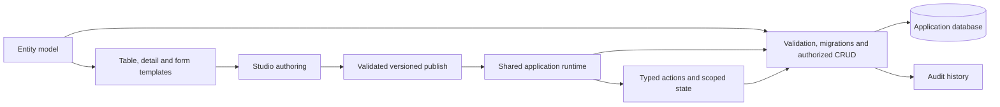

# Enterprise application architecture

Mosaic's product goal is to shorten the journey from a business data model to a
maintainable application. Its first complete workflow should be a team managing
customers, orders, cases, or requests: search records, create and edit them,
open a detail view, perform an authorized business action, and inspect history.
These workflows determine platform priorities and release acceptance.

This document records the intended architecture. The implementation status below
distinguishes capabilities available now from capabilities still being built.

## Business outcomes and delivery model

| User | Job | Platform outcome |
| --- | --- | --- |
| Application developer | Define entities and business rules | Reuse migrations, validation, CRUD, permissions, and audit |
| Application builder | Compose a business workflow | Start from an entity table, detail view, and reusable form; configure bindings and actions |
| Business operator | Complete work accurately | Consistent search, validation, loading/error states, and clear action results |
| Application owner | Change the application safely | Versioned publishing, reviewable migrations, recovery, and rollback |
| Operations team | Run the application | Documented database/API/web deployment, health checks, logs, and backups |

The initial delivery unit is a deployable application with its own database and
configuration. PostgreSQL supports production storage; PGlite provides local
development and evaluation. Multi-tenant SaaS, enterprise identity federation,
and long-running workflow orchestration require explicit additional work.

Measure acceleration using the same reference application on each release.
Record time to scaffold and start, time to the first usable table/detail/form,
time to a custom business action, and time to a successful deployment. Also record
handwritten application code, failed setup steps, accessibility defects, and
support effort. Publish measured results when a repeatable baseline exists.

## Architecture decisions

### One API with explicit module boundaries

Keep the API a modular monolith and deploy it as one service. Entities,
migrations, artifacts, identity, files, settings, and audit own their rules and
storage access. Shared contracts live in `@mosaic-apps/core`. Extract a service
only when deployment or workload isolation has a measured benefit.

Studio is the authoring application. `@mosaic-apps/ui` is the application runtime.
Generated applications depend on the public packages and retain editable source.
The API applies authorization independently of the Studio and runtime UI.

### An entity starts a complete workflow

The target **Create application view** flow chooses an entity and produces a
linked table, detail view, and create/edit form. Entity metadata supplies column
suggestions, labels, field types, relation pickers, and validation hints. The
builder can customize the generated definitions and preserve those overrides.

Table configuration owns visible columns, order, formatting, search, filters,
pagination, selection, row actions, and drilldown. Form settings own form-level
identity, data sources, submission, layout, and metadata. Page settings own route,
shell, access, navigation, and metadata. Component properties own local behavior.

This generation flow is planned. Existing entity CRUD, forms, tables, and
inline detail behavior provide its building blocks.

### Metadata is a versioned public contract

Definitions must remain JSON serializable. A component registry entry describes
its runtime renderer, defaults, inspector fields, binding behavior, and supported
events. The registry is the extension point for custom components.

Add an explicit definition schema version and migrations before introducing
incompatible metadata changes. The publishing boundary should validate component
types, action schemas, bindings, references, cycles, and route conflicts and
return issues against the affected node/property. Preserve the last usable
published definition when validation fails.

Atomic save/publish and stale-version rejection are implemented for forms and
pages. Comprehensive definition validation, page release history, rollback, and
environment promotion remain work to complete. Save remains the primary authoring
action; any future review workflow must be an explicit workspace policy.

### State has clear owners

| State | Owner | Lifetime and rule |
| --- | --- | --- |
| Business records | API/database | Authoritative data; permissions and transactions run on the server |
| Remote query results | Runtime data controller, planned | Keyed by entity/query; cancellation, invalidation, pagination and errors |
| Application context | `MosaicState.application` | Application session; reset on logout/session change |
| Page context | `MosaicState.page` | Page instance, selection and route context |
| Form draft | `MosaicState.form` | Form instance; bound inputs and action writes share the same values |
| Component state | `MosaicState.component` | Component instance; local interaction and action status |
| Studio authoring state | Designer store | Definition, selection, undo/redo, dirty baseline, preview, saves and conflicts |

Keep business records separate from transient interface state. A state write
updates the interface; persisting a business record requires an API action.
Nested forms share application/page context and own their form draft. Parent
bindings carry child values and initial props.

Current runtime stores support isolated scopes, subscriptions, snapshots, and
restoration. Draft recovery, remote query caching, cross-tab coordination, and
aggregate nested-form validation need implementation. Persistence should be opt
in and avoid retaining sensitive records by default.

### Actions are typed; business invariants run on the server

Use declarative actions for common behavior: messages, API calls, state changes,
and navigation. Add confirmations, response mapping, conditional branches, and
table row context as reusable actions. The same action runner executes configured
actions and the actions returned by custom scripts.

**Execute script** opens a Monaco modal. Scripts read a state snapshot and return
typed actions. QuickJS runs in a browser worker with bounded CPU and memory and
without host DOM/network access. This supports interface calculations and
orchestration; server endpoints enforce business invariants such as approval,
pricing, entitlement, and state transitions. External integrations and secrets
belong behind authorized server endpoints.

An approval transition should use an authorized server command that checks the
current record version/status, updates the record in a transaction, and records
an audit event. Retries, idempotency keys, an outbox, and durable jobs are planned
for operations that can outlive a browser session.

### Design and preview share rendering contracts

Use the same registered components in Studio and generated apps. Bits UI and
shadcn wrappers provide consistent keyboard interaction. Inline preview uses the
runtime renderers; script authoring uses a modal with Apply/Cancel. Configure
responsive layouts, accessible labels, loading/empty/error states, and semantic
theme tokens through reusable defaults.

The remaining component audit, named-theme gallery, preference persistence,
validated logo upload, and application shell integration are release backlog.
Page access settings also need runtime enforcement; merely storing a setting is
insufficient acceptance evidence.

## Delivery priorities and acceptance

| Priority | Deliverable | Acceptance evidence |
| --- | --- | --- |
| P0 | Reliable authoring and package consumption | Clean install/start; Button drop/save; script modal; inline preview; isolated npm consumer build |
| P1 | Entity-to-workflow generator | Customer/order reference app generated with searchable table, form, detail, relation bindings and CRUD |
| P1 | Complete state and data lifecycle | Script updates inputs; stale loads cancelled; explicit save errors; nested values/validation; draft recovery/conflict resolution |
| P1 | Definition validation and governance | Invalid metadata rejected with node issues; stale publish handled; migration review; reproducible rollback |
| P2 | Consistent UX and branding | Component keyboard audit; parity of form/page settings; responsive shell; named themes; uploaded branding |
| P2 | Business actions and integrations | Confirmed actions; row context; response mapping; server commands with authorization/audit/idempotency |
| P2 | Production operations | PostgreSQL/API/web deployment exercise; durable uploads; health/logging; backup and restore evidence |
| P3 | Larger-enterprise adoption | SSO and authorization review; tenant design where needed; environment promotion; operational workload evidence |

Publish packages only after typechecks, relevant regression checks, tarball
inspection, and a fresh consumer install/build. Record unresolved limits in the
release notes. A package release is distinct from deploying an application.
See [Releasing packages](./releasing.md) and the public
[Deployment guide](../docs/docs/deployment.md).
